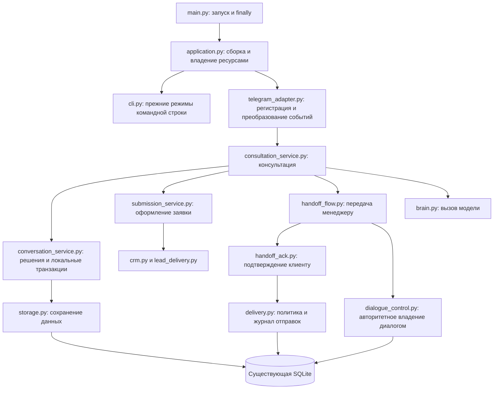

# Постепенный рефакторинг ANASTASIA в модульный монолит

Дата: 17 ноября 2026 года.

Результат находится в `modular_refactor/ANASTASIA_4_20`. Основа — `dialogue_fix/ANASTASIA_4_20`, то есть версия после исправления владения диалогом, а не более ранняя распаковка RAR. Исходная папка, архив, рабочие базы, Telegram-сессии и секреты не изменялись. Документы исходного проекта использованы как справочная информация, а не как дополнительные поручения.

## Границы модулей



Стрелки показывают поток выполнения и зависимостей; сервисы получают конкретный экземпляр `Application`, хранилище, Manager и транспорт явно. Они не импортируют composition root. Статический граф всех локальных Python-импортов, включая импорты внутри функций, ацикличен.

## Изменения по шагам

1. Зафиксирован исходный результат: **371 passed, 10 subtests passed**, 6.59 секунды.
2. Из `main.py` вынесены CLI, Telegram-адаптер и сценарии. `main.py` вызывает фабрику, запускает приложение и закрывает его в `finally`. Регистрация Telegram-обработчиков делегирована `telegram_adapter.listen`. Прежние режимы CLI, строки команд, ограничения и ответы перенесены без изменения их назначения.
3. `Application` владеет Store, Manager, FamilyRadar, SalesLearning и контейнерами состояния конкретного экземпляра: блокировками чатов, ожидающими вопросами, групповыми ответами и тестовыми сессиями. `create_application(data_dir)` создаёт существующие четыре базы по указанному пути. Нет импортируемых экземпляров `STORE`, `M`, `RADAR`, `LEARNING`.
4. `handle_dm` преобразует Telegram event в `ConsultationInput`. Сценарий консультации больше не получает объект Telethon event. Оформление заявки находится в `submission_service`; передача и подтверждение — в `handoff_flow` и `handoff_ack`.
5. Распознавание текста, переходы по ответам, согласия и аналитические решения вынесены из Store в `ConversationState`. Store содержит операции сохранения. Сервис управляет транзакцией, а примитивы `write_contact`, `append_turn`, `insert_inbound`, `write_effect` не выполняют самостоятельный commit.
6. Схема журнала вынесена в `delivery_schema`. Store больше не создаёт Ledger и не импортирует delivery. Подтверждение отправки вынесено из `DialogueControl` в `HandoffAcknowledgement`. Общие часы и SAFE_TEST_MODE отделены от транспорта, что устранило и косвенные циклы `outgoing ↔ delivery`.
7. В `brain.respond` нет скрытого `Store()`: вызывающий код передаёт Manager и разрешённую конфигурацию. Для библиотечного вызова без конфигурации используются только настройки окружения, без чтения рабочей базы. Все обращения через `globals()` удалены. Команды менеджера и генерация распоряжений/кампаний также получают зависимости явно.
8. Закрываются ресурсы приложения, предыдущие тестовые сессии при сбросе, тестовые сессии при выходе, временный Manager проверки GPT и клиенты модели. Уже созданные ресурсы закрываются и при неудаче следующего конструктора. Процессный lock закрывается при ошибке подготовки Telegram-клиента.

Это один процесс с прежними SQLite-файлами и библиотеками. Новая СУБД, микросервисы и фреймворк не добавлялись. Независимые подсистемы каталога сообществ, автоприсоединения и их файловая конфигурация не переписывались. Изоляция проверена для ресурсов приложения, состояния консультации, доставки и тестовых сессий; переменные окружения и прежние файловые настройки сохраняют прежнюю область действия.

## Транзакции и внешние эффекты

- Claim входящего события, аналитические события и запись в журнал фиксируются одной локальной транзакцией. Указатель текущего входящего события попадает в память только после commit.
- Факты, доказательства и состояние диалога фиксируются вместе. Ответ ассистента, следующий ожидаемый вопрос и отметка ответа в inbox также фиксируются вместе.
- Согласие на заявку и состояние заявки фиксируются вместе. Подтверждённый CRM ID, закрытие pending, эффект `sent` и свидетельство `lead_created` фиксируются вместе. `uncertain` и соответствующее состояние заявки тоже атомарны.
- Claim внешней операции коммитится до сетевого `await`; результат сохраняется после него. Сеть не удерживает SQLite-транзакцию. Отказ, неопределённый результат и отмена не дают права на автоматическую повторную отправку.
- Сохранены проверки согласий, запрета исходящих, ограничений аккаунта, дедупликация событий/заявок, лимиты и повторная проверка владения перед отправкой. Исправление диалога из предыдущего этапа сохранено.
- Контекст активной отправки теперь содержит идентичность Store: операция одного приложения не может предоставить исключение отправке другого приложения с тем же адресатом и ключом.

## Фактическая проверка

Полный финальный запуск:

```powershell
.\.venv\Scripts\python.exe -X utf8 modular_refactor/ANASTASIA_4_20/run_tests.py --tb=short
```

**386 passed, 10 subtests passed, 10.43 секунды.** Протокол сохранён в `TEST_RESULTS.txt`, подробности — в `TEST_RESULTS.xml`.

Все прежние 371 проверки сохранены. Тесты адаптированы к явному созданию приложения и вызову сервисов; assertions старых сценариев сохранены. Старый тест с извлечением функций из AST main.py заменён вызовами реальных сервисов. Добавлены 15 проверок:

- импорт всех библиотечных модулей и main в двух порядках, в свежих subprocess, с запретом `sqlite3.connect` и сетевых подключений;
- отсутствие циклов локальных импортов и `globals()`;
- одновременная обработка одинакового Telegram-события двумя приложениями с отдельными временными базами, независимые история, владение, блокировки, тестовые сессии и повторное открытие;
- закрытие соединений, повторный close, замена тестовой сессии и частичная ошибка сборки;
- пять сценариев отката локальных изменений и отдельный сбой последней записи после получения CRM-квитанции;
- отсутствие транзакций во время вызовов модели, CRM и транспорта;
- отсутствие повторного создания CRM после неопределённого результата;
- невозможность использовать контекст отправки другого приложения;
- отсутствие открытия базы непосредственно внутри `respond`;
- закрытие приложения при ошибке запуска.

Runner копирует код во временный каталог без `.env`, рабочих баз и сессий, очищает конфигурацию окружения. Внешние транспорты подменены; сетевые подключения запрещены. Реальные Telegram/OpenAI/CRM-запросы не выполнялись.

Дополнительная проверка обновления:

```powershell
.\.venv\Scripts\python.exe -X utf8 modular_refactor/check_upgrade.py
```

Временные базы заполнялись кодом предыдущей версии, затем открывались фабрикой нового приложения. **Схемы и все строки до и после совпали**, `integrity_check=ok` для всех четырёх файлов:

| База | Таблицы | Строки |
|---|---:|---:|
| softskills.db | 22 | 16 |
| manager.db | 6 | 2 |
| family_radar.db | 3 | 1 |
| sales_learning.db | 5 | 3 |

Подробности сохранены в `UPGRADE_CHECK.json`. Это проверка на синтетических непустых базах, не запуск на рабочих данных.

## Артефакты

- `ANASTASIA_4_20/` — обновлённый код, тесты, прежние командные файлы запуска и `.env.example`.
- `ANASTASIA_MODULAR.zip` — код без рабочих баз, `.env` и Telegram-сессий.
- `modular_refactor.patch` — изменения относительно `dialogue_fix/ANASTASIA_4_20`.
- `UPDATE_MANIFEST.json` — перечень изменённых файлов и контрольные суммы.

Для переноса используются изменения кода поверх исправленной версии диалога; существующие `data`, `.env` и сессии сохраняются. Автоматического развёртывания или изменения рабочих данных этот этап не выполнял.
